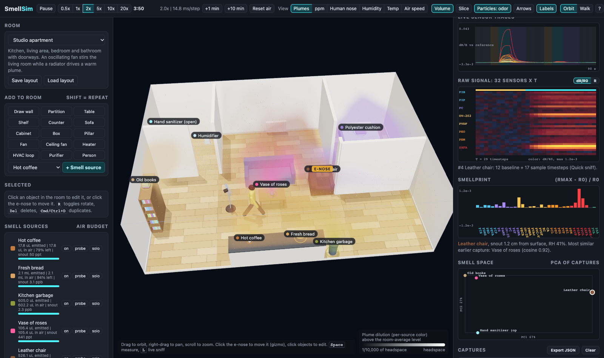

# SmellSim: a Cyranose 320 in a room

An interactive three.js simulator of how smell moves through a sealed room, and what a handheld
32-sensor electronic nose (modeled on the Cyranose 320) would record near different objects,
materials and situations.



## Run

```bash
npm install
npm run dev        # http://localhost:5173
npm run build      # type-check + production bundle in dist/
```

## What you can do

- **Rooms**: six presets (studio apartment, materials lab, kitchen and dining, open office, gallery
  atrium with a mezzanine, test chamber). You can resize the room, change the grid resolution, draw
  walls, and add partitions, tables, shelves, counters, sofas, cabinets, boxes and pillars.
- **Smell sources**: 33 types across food and drink, materials (timber, paper, cardboard, leather,
  plastic, rubber, fabric, brass, steel, glass, wax, brick), plants and earth, household products,
  and people. Each source can be toggled, scaled, set to spray in puffs, or given a depletion time.
- **Air currents**: oscillating pedestal fans, ceiling fans, radiators (buoyant plumes),
  recirculating HVAC loops with HEPA or carbon filters, and air purifiers. People walk around on
  A* paths, adding wakes, heat, breath humidity and bioeffluents. A person can wear a scent.
- **Visualization**: ray-marched volume and an optional slice. View modes are plume dilution, ppm,
  human odor activity, humidity, temperature and air speed. You can also show tracer particles
  (odor puffs or air streaks), velocity arrows, and labels, and solo a single plume.
- **Decay and conservation**: ozone chemistry, surface uptake, filters and source depletion. The
  legend shows each source's budget: emitted = airborne + decayed + filtered.
- **E-nose**: move it with the gizmo (`T` selects it), snap the snout to any object, or carry it in
  walk mode. Run a measurement cycle (baseline through the side inlet, sample through the snout,
  purge) or a live sniff. The panel shows:
  - live traces of all 32 sensors;
  - the **raw 32 x T signal** as a heatmap (dR/R0 or raw resistance);
  - the **smellprint** `(Rmax - R0) / R0`;
  - a **PCA** of all captures;
  - ground-truth compounds at the snout and a PID total-VOC reading;
  - a human-nose comparison with adaptation, and a snout camera.

  Captures export as JSON with raw resistances, smellprints and ground truth.

Keys: `Space` measure, `L` live sniff, `P` pause, `T` select e-nose, `R` rotate selection, `Del`
delete, `Cmd/Ctrl+D` duplicate, `Shift`+click to keep placing. Walk mode: `WASD`, mouse, `Q`/`E`,
scroll changes arm reach.

## How it works

See [docs/RESEARCH.md](docs/RESEARCH.md) for the physics and sources. Briefly:

- `src/sim/fluid.ts`: incompressible stable-fluids solver on a voxel grid with obstacles
  (semi-Lagrangian RK2 advection, red-black SOR projection, vorticity confinement, explicit eddy
  diffusion).
- `src/sim/world.ts`: sources, decay channels, fans, HVAC, heat, humidity, people, probes with
  sub-grid near-field headspace, mass and energy conservation, and volume compositing. It runs in a
  Web Worker (`src/sim/worker.ts`).
- `src/device/sensors.ts`: LSER partitioning, swelling, percolation, sorption kinetics, drift and
  noise for 32 polymers.
- `src/device/cyranose.ts`: pump, two inlets, tube and chamber volumes, measurement phases and
  smellprints.
- `src/render/`: multipass renderer. The HDR scene is ray-marched against scene depth, followed by
  room, people, device and visualization layers.
- `src/ui/`: panels, charts and the 3D editor.

Scripts in `scripts/`:

- `bench.ts`: headless performance and mass check. Run with `npx tsx scripts/bench.ts studio 60`.
- `sensor_check.ts`: smellprint magnitudes and similarities per source.
- `viz_debug.ts`: plume visibility diagnostics.
- `screenshot.mjs`: headless Chrome smoke test with screenshots. It needs the dev server running.

## Calibration to the New York Smells Cyranose (sim2real)

The default sensor model (**Sensors: Fitted to New York Smells unit** in the e-nose panel) is fitted
to 6,934 real captures from the [New York Smells](https://smell.cs.columbia.edu) dataset (CC BY 4.0),
so simulated channel *i* behaves like real channel *i*. The literature polymer set is still
available as an alternative.

What the fit found on that unit:

- Channels S3, S7, …, S31 (every 4th) are non-sensing positions. They sit at an identical level,
  have a two-level readout and occasional shared glitch episodes, and don't correlate with the
  other channels. The other 24 channels are the active sensors.
- The dominant real signal is humidity. Baseline resistance tracks recorded ambient humidity
  within a session, and plants raise humidity at the snout by about 100–600 ppm.
- The snout air is on average drier than the side-inlet air, so most raw smellprint values are
  negative.
- Slow common-mode wander lives mostly in the side-inlet (baseline) air.
- Plastics, paper, cardboard, textiles and wood are near the noise floor in the wild.

Model components:

- per-channel LSER chemistry (fitted with priors from the literature set);
- per-channel water and temperature sensitivities from the ambient regression;
- per-channel levels and noise;
- inlet offsets bootstrapped from real inert-object captures;
- slow wander and the non-sensing channel readout, tuned to within-capture statistics.

The table compares 4,000 simulated captures with the real data:

| Metric | Fitted | Literature |
| --- | --- | --- |
| Real-vs-sim linear classifier, active-channel mean shifts (0.5 = indistinguishable) | 0.53 | 0.97 |
| Real-vs-sim linear classifier, smellprints | 0.65 | 0.97 |
| Per-channel response magnitude ranking (Spearman) | 0.96 | -0.20 |
| Mean-shift correlation matrix agreement | 0.72 | 0.06 |
| Per-material response direction (mean cosine; >0.9 for plants, food, bark, rubber, leather) | 0.77 | 0.07 |
| Held-out objects: explained material-specific variance | 0.32 | < 0 |

Known remaining gap: the fine within-capture noise structure (per-channel noise dynamics) is still
distinguishable. The planned fix is to inject real blank traces when generating training data.

Reproduce the fit (requires the dataset's `olfaction` parquet files in `/tmp/nys_data`):

```bash
uv run --with pyarrow --with numpy python -I scripts/nys_fit/extract_targets.py /tmp/nys_data data/nys_targets.json
uv run --with pyarrow --with numpy python -I scripts/nys_fit/ambient.py /tmp/nys_data data/nys_targets.json
npx tsx scripts/nys_fit/export_chem.ts data/sim_chem.json
uv run --with torch --with numpy python -I scripts/nys_fit/fit.py \
    data/nys_targets.json data/sim_chem.json data/nys_ambient_slopes.json src/chem/nysCalibration.json
# validate
npx tsx scripts/sim_captures.ts 4000 /tmp/sim_nys/sim_nys.json nys
uv run --with pyarrow --with numpy --with scikit-learn python -I scripts/nys_fit/compare.py /tmp/nys_data /tmp/sim_nys/sim_nys.json
```

`scripts/nys_fit/` also contains the exploratory analyses used along the way: `explore.py`,
`channels.py`, `drift.py`, `excess.py`, `dead_channels.py` and `within_stats.py`.

## Caveats

Compound descriptors, odor thresholds, headspace levels and polymer coefficients are approximate
literature values or chemically motivated estimates. They give plausible relative behavior, but
they are not calibrated to a specific instrument. The real NoseChip polymer set is proprietary.
The grid (15-30 cm) does not resolve centimeter-scale boundary layers, so the snout sees an
analytic near-field term on top of the resolved field.
